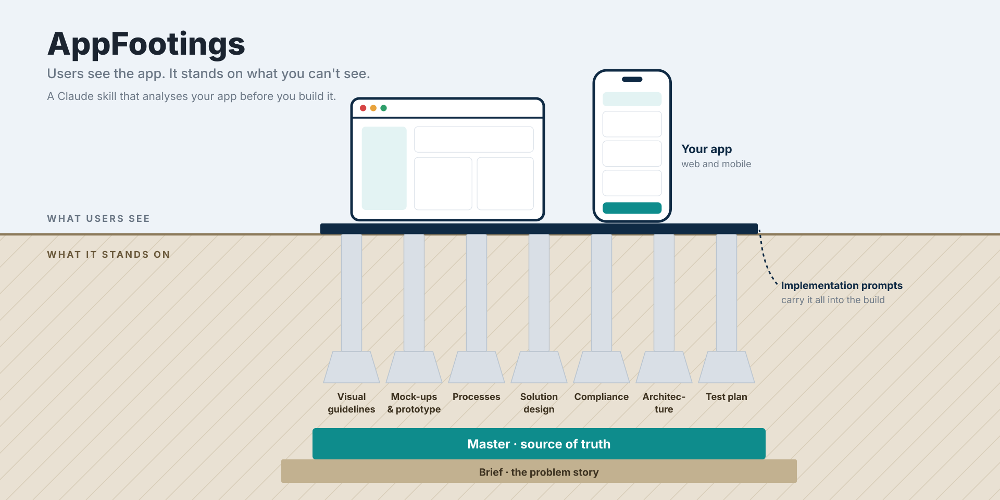
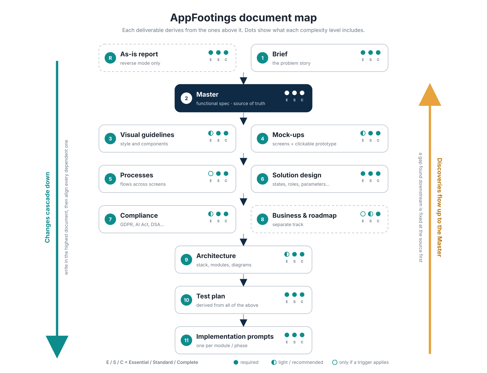
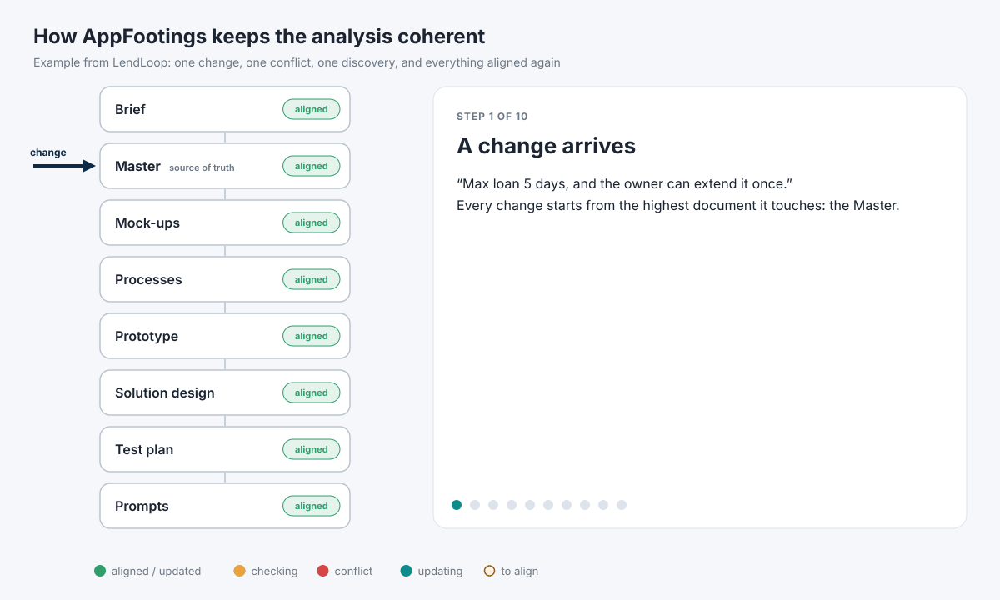
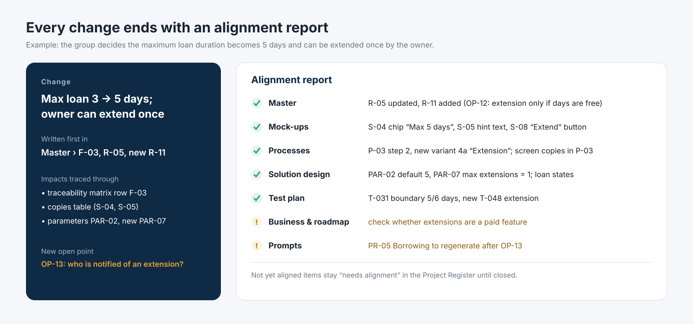
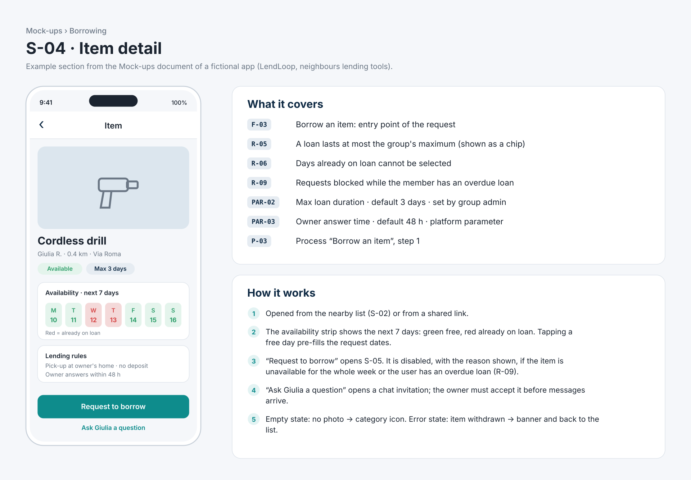
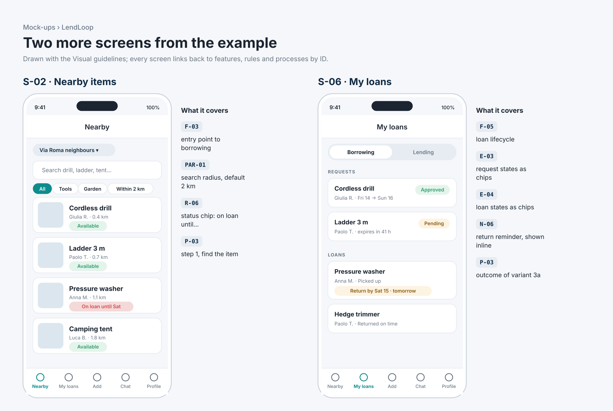
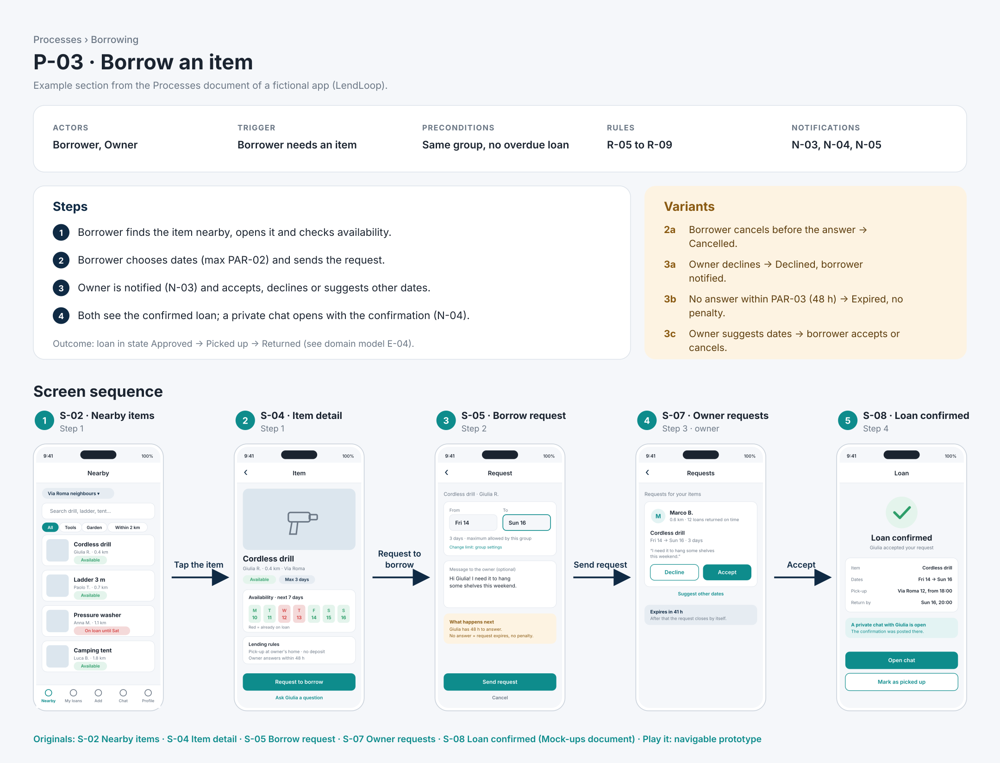
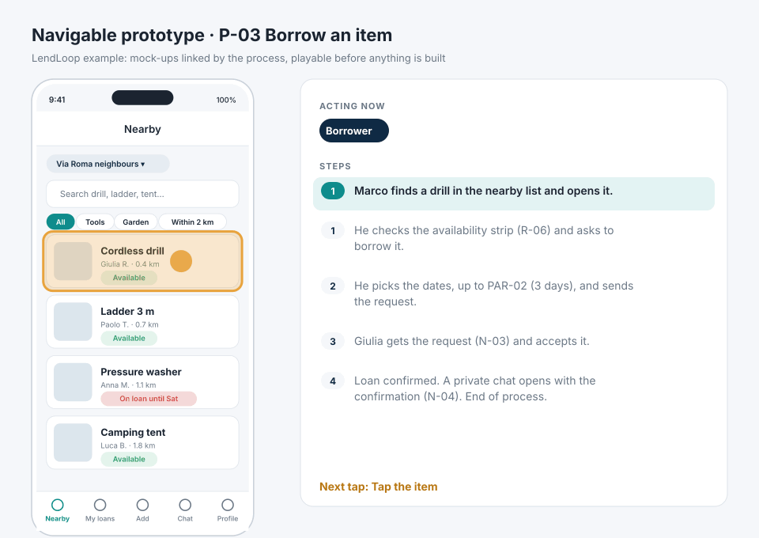

# AppFootings

**Lay the foundations of your app before you build it.**



AppFootings is a skill for Claude that walks you through the full analysis of an app or digital product. It starts with you telling the story of the problem and ends with a set of implementation prompts a coding agent can follow. Along the way it:
- produces **real project deliverables** you can show to a client, a partner or a development team, including mock-ups and a **clickable prototype** of the app;
- keeps every document aligned and flags what is missing or contradictory;
- gives you a reasoned recommendation when you are unsure how to proceed.

It works on a new idea or on a **project already under way**: in that case it starts by reading your code and documents.

> **Why the name.** Footings are the foundations poured below ground before a building goes up. Users never see them, yet everything stands on them. In AppFootings, the footings are the deliverables, and the Master and the Brief are the bedrock they rest on. The app is what users see. Changing a spec costs a sentence; changing code costs a sprint.

---

## Contents

- [Why AppFootings](#why-appfootings)
- [What it does](#what-it-does)
- [Mindset: the analyst behind the skill](#mindset-the-analyst-behind-the-skill)
- [The phases and their deliverables](#the-phases-and-their-deliverables)
- [Three complexity levels](#three-complexity-levels)
- [How documents stay aligned](#how-documents-stay-aligned)
- [Advisor mode](#advisor-mode)
- [Examples](#examples)
- [Navigable prototype](#navigable-prototype)
- [Reverse analysis: adopt it mid-project](#reverse-analysis-adopt-it-mid-project)
- [The implementation prompts](#the-implementation-prompts)
- [Installation](#installation)
- [The most effective way to use it](#the-most-effective-way-to-use-it)
- [How to use it](#how-to-use-it)
- [Tips](#tips)
- [FAQ](#faq)
- [Repository structure](#repository-structure)
- [License](#license)

---

## Why AppFootings

AI coding agents build fast. The bottleneck has moved from writing code to knowing exactly **what** to build. Vague or contradictory requirements now cost even more, because an agent will happily build the wrong thing at full speed.

Most analysis work fails in predictable ways:

- requirements are scattered across chats, notes and slides, and nobody knows which version is right;
- a decision changes, and the mock-ups, flows and test cases quietly keep the old one;
- edge cases surface during development: what if the other person never answers? who can cancel what?
- business decisions like plans, limits and prices get made on features the spec doesn't have;
- design, legal and technical aspects are remembered too late, or never.

AppFootings turns analysis into an ordered process with one source of truth, a strict change procedure and a final hand-off that carries everything into the build.

---

## What it does

AppFootings does three jobs at once.

| | Job | What it means in practice |
|---|---|---|
| 🧭 | **Method** | An ordered sequence of phases, each producing a deliverable, scaled to the size of your project |
| 🔗 | **Governance** | Documents have a hierarchy. Every change is checked for coherence first, and conflicts are raised to you. Changes cascade down, discoveries flow up to the Master, and every change ends with an alignment report |
| 💬 | **Advisor** | Recommends the next step, helps prioritise, frames decisions with proven patterns, and pushes back when something doesn't add up |

The final output is a **set of implementation prompts** covering every functional, design and technical requirement, ready for a coding agent or a development team.

### Deliverables you can actually use

Every document is **project-grade**: it can go to a client, a partner, an investor or a development team as it is, without a separate presentation version to keep aligned. In practice:
- each document opens with a header giving its version, date, status and purpose;
- the content is self-explanatory, with no conversation residue;
- terminology is consistent;
- every deliverable comes in a shareable format: a living document, a design file, a prototype link, or a PDF export.

AppFootings talks to you and writes its documents **in your language**. The skill itself is written in English.

---

## Mindset: the analyst behind the skill

AppFootings works like a senior analyst who brings three competences. It does not just record requirements: it asks the questions you should be asking yourself.

| Competence | What it means |
|---|---|
| **Functional analyst first** | Goals, rules, edge cases, responsibilities. Technical knowledge (feasibility, cost, security, performance) comes in when it changes a decision, not before |
| **Web and mobile product expert** | Knows the conventions users expect because they are de facto standards: sign-in, navigation, empty and error states, notifications, account deletion, offline, accessibility, store rules. Also knows what an app needs to run well in production. It proposes these as defaults so you don't have to remember them |
| **Domain expert, by research** | Researches the subject of your app on the web: how the activity works, its rules and regulations, comparable products and their models. It uses this to sharpen its questions and proposals, cites its sources, and marks everything as a proposal for you to confirm |

How deep it goes depends on the level you choose:
- **Essential:** critical questions and a quick domain scan;
- **Standard:** systematic questions and the main comparable products;
- **Complete:** every aspect explored, with a structured benchmark.

---

## The phases and their deliverables

Each phase produces one deliverable, and each deliverable builds on the ones before it.



**(R) Reverse analysis → As-is report** *(only for existing projects)*
Reads your code, documents and tickets, and reconstructs what the solution already does: features, roles, states, rules, screens and integrations. Every item is tagged with where it was found. It also lists where the code and the documents disagree. [More below](#reverse-analysis-adopt-it-mid-project).

**1. Problem story → Brief**
You tell the story of the problem, ideally by voice, and AppFootings asks targeted questions while it researches the domain. The Brief covers the problem, users and primary target, scenarios, alternatives, goals, constraints, business intent, out of scope and the proposed level.

**2. Functional analysis → Master**
Defines what the solution does, feature by feature, with rules, edge cases and defaults. It holds the glossary, the roles and the open points. **It is the source of truth:** every other document derives from it.

**3. Visual language → Visual guidelines**
Fixes the style before any screen is drawn: base system, palette, typography, spacing, components and their states, motion, copy and accessibility. AppFootings helps you set it up from reference apps you like and recommends design tools.

**4. User experience → Mock-ups**
One section per screen: the drawing, *What it covers* (features, rules and parameters by ID) and *How it works* (interactions, states, edge cases). It makes the analysis tangible and tests the Master against real screens.

**5. Flows → Processes + navigable prototype**
Describes each end-to-end flow step by step: actors, trigger, steps, variants, outcomes and the screen sequence. It then links the mock-ups into a **clickable prototype** that plays those flows, so anyone can try the app before it exists.

**6. Solution design → Solution design**
Decides how the solution is structured:
- domain model and states, permissions, parameters and feature flags;
- modularity, integrations, form factor and app type;
- audit, APIs, authentication, notifications;
- offline, multi-tenancy, data lifecycle, media, localisation, accessibility;
- edge cases, measurable NFRs, observability.

**7. Legal → Compliance**
Spots legal constraints early so they shape the design: GDPR, AI Act, ePrivacy, DSA, Accessibility Act, consumer protection, payments, app stores, minors, licences. It is a preliminary risk analysis, not legal advice.

**8. Value → Business & roadmap**
Defines segments, plans and limits, pricing logic, cost drivers, comparable models and release phases. It is a separate track, written only after the Master converges, but it is checked against everything else.

**9. Technical analysis → Architecture**
Covers stack, modules and protocols, data, security, deployment, observability, scalability, running costs and a decision log, with diagrams.

**10. Verification → Test plan**
Derives tests almost automatically from processes, rules, permissions, states, parameters, notifications, compliance and NFRs, so every requirement is verifiable.

**11. Hand-off → Implementation prompts**
A permanent rules file plus one prompt per module and phase. Each prompt carries its scope, rules, screens, acceptance criteria and tests, ready for a coding agent or a team.

Closing an open point does **not** produce a document. The decision is written into the Master and cascaded to every document it affects.

---

## Three complexity levels

Not every project needs everything. After the Brief, AppFootings proposes a level based on what it has learned, with a one-line reason. You confirm it or pick another.

| Level | Typical project | Signals |
|---|---|---|
| **Essential** | Personal or internal tools, prototypes, MVP experiments | 1–2 roles, under ~10 screens, no sensitive data, no monetisation |
| **Standard** | Real products with external users | Several roles, hand-offs between people, personal data, some integrations |
| **Complete** | Platforms and market products | Multiple organisations, monetisation, marketplace, payments, AI, high volumes, public API |

### Deliverables per level

● required · ◐ recommended or light · ○ only if a trigger applies

| Deliverable | Essential | Standard | Complete |
|---|---|---|---|
| As-is report (reverse mode only) | ● inventory + discrepancies | ● + screen map and rules | ● + NFR and security evidence |
| Brief | ● short | ● | ● |
| Master | ● | ● | ● |
| Visual guidelines | ◐ existing base + tweaks | ● | ● full design system |
| Mock-ups | ◐ key screens | ● all screens | ● all screens + states |
| Processes | ○ | ● main processes | ● all, with variants |
| Navigable prototype | ◐ main flow, linked straight from the mock-ups | ● main processes | ● all processes and variants |
| Solution design | ● subset | ● | ● |
| Compliance | ◐ quick checklist | ● | ● |
| Business & roadmap | ○ | ◐ roadmap | ● |
| Architecture | ◐ stack + deployment | ● with diagrams | ● with diagrams + alternatives |
| Test plan | ● functional | ● + basic NFR | ● + performance and security |
| Implementation prompts | ● 1–2 prompts | ● one per phase | ● one per module and phase |

<details>
<summary><b>Solution design aspects per level</b></summary>

| Aspect | Essential | Standard | Complete |
|---|---|---|---|
| Domain model and states | ● | ● | ● |
| Form factor and app type | ● | ● | ● |
| Roles and permissions | ◐ | ● | ● |
| Parametrisation | ◐ defaults only | ● user + platform | ● + feature flags |
| Empty states, errors, edge cases | ◐ | ● | ● |
| Identity and authentication | ◐ | ● | ● |
| Audit and traceability | ○ | ● | ● |
| Notifications | ○ | ● | ● |
| Data lifecycle | ○ | ● | ● |
| Files and media | ○ | ◐ | ● |
| Accessibility | ◐ | ● | ● |
| External integrations | ○ | ◐ | ● |
| Measurable NFRs | ◐ | ● | ● |
| Modularity / pluggability | ○ | ◐ | ● |
| Public API layer | ○ | ○ | ● |
| Multi-tenancy | ○ | ◐ | ● |
| Offline and sync | ○ | ◐ | ● |
| Localisation | ○ | ◐ | ● |
| Observability and product metrics | ○ | ◐ | ● |

</details>

### Levels are not watertight

If something important comes up, AppFootings proposes the related aspect at any level and tells you why.

| If this emerges… | AppFootings proposes… |
|---|---|
| personal data | full GDPR section + data lifecycle |
| AI in the features | AI Act classification, transparency, human oversight |
| payments or money between users | PSD2/AML check, full audit, security tests |
| several roles or hand-offs | permissions matrix + Processes |
| use on the move, poor connectivity | offline and sync |
| external systems to connect | integrations (+ API layer) |
| the product is sold | Business & roadmap, with business questions already in the Brief |
| several organisations or customers | multi-tenancy |
| user content or marketplace | DSA, moderation, reporting |
| possible minor users | protections for minors |
| many users, peaks, real time | NFRs, observability, performance tests |
| behaviour to tune without releases | parameters and feature flags |
| regulated sector | sector rules, stronger audit |

You can raise the level at any time. AppFootings lists what gets added and aligns it like any other change.

---

## How documents stay aligned

This is the heart of AppFootings. An analysis is never written once. It changes every time you learn something, and each change can silently break something already documented. AppFootings treats the documents as **one system with a hierarchy**, and runs the same loop on every change:

1. **Start at the top.** The change goes to the highest document it touches, usually the Master.
2. **Check coherence before writing.** The change is compared with everything already documented: rules, states, permissions, parameters, screens, processes, plans.
3. **Raise conflicts, don't hide them.** If something contradicts, AppFootings stops and brings it to you. It names the documents and IDs involved and recommends a resolution. Nothing is written until you decide.
4. **Cascade down.** Once decided, impacts are traced by ID and every dependent document is updated in order: mock-ups, processes, prototype, design, tests, prompts.
5. **Let discoveries flow up.** If updating a lower document reveals a new gap, the cascade pauses. The gap goes back up to the Master to be decided, then the cascade resumes.
6. **Close with an alignment report.** The loop ends only when a full pass finds nothing new. You get a list of what changed where.



The result: however many times you change your mind, the mock-ups, flows, prototype, tests and prompts always say the same thing as the Master.

### The rules

1. **The Master wins.** Every decision is written there first. No other document may contradict it.
2. **Think in order.** First what it does, then how it looks and flows, then how it is built. How it is sold comes once the Master has converged. Business *questions* are asked early, because limits and plans become parameters of the design.
3. **Changes cascade down.** A change starts in the highest document it affects and is then propagated to every dependent document, in order.
4. **Discoveries flow up.** If a mock-up, process or test reveals a gap, it is not patched where it was found. It goes up to the Master first, then cascades down again.
5. **Open points live in the Master,** with an ID, until they are decided.
6. **Every change ends with an alignment report**, which says explicitly what is not aligned yet.

The alignment report as it looks halfway through the loop above, while the discovery (OP-13) is still open:



### Stable IDs and traceability

Every traceable item gets a short, stable ID: `F-` features, `R-` rules, `OP-` open points, `ROLE-` roles, `S-` screens, `P-` processes, `E-` entities, `PAR-` parameters, `N-` notifications, `NFR-`, `INT-`, `LEG-`, `ARC-`, `T-` tests, `PR-` prompts, and `AS-` as-is findings in reverse mode.

A **traceability matrix** links each feature to its rules, screens, processes, parameters, plan, roadmap phase, tests and prompt. When `F-03` changes, its row tells you exactly what to revisit.

### Project Register

AppFootings keeps a small register as a working tool. It records:
- the chosen level and the active triggers;
- every document with its link, status and last change;
- a **copies table** listing where content was duplicated by hand, such as screen thumbnails copied into processes or screens used in the prototype, so those copies get updated too.

### Coherence checks

At the end of each phase and after significant changes, AppFootings checks, among other things, that:
- every scenario is covered;
- indexes match their sections;
- every screen a process references exists;
- every hotspot in the prototype leads where the process says;
- every role and action pair is allowed in the permissions matrix;
- every state and transition exists in the domain model;
- every default is a parameter with the same value;
- every compliance requirement and NFR is designed and tested;
- in reverse mode, every as-is finding is resolved or explicitly accepted.

---

## Advisor mode

Ask AppFootings when you're stuck. It reads where the project stands and answers with a recommendation, not a menu.

**"What should I do next?"** You get one next step and the reason for it, for example: *"Resolve OP-04 and OP-07 first: they block three mock-ups."* It also warns against common traps:
- designing the business model before the Master converges;
- choosing technology before the functional analysis;
- drawing screens before the visual guidelines exist;
- piling up features while open points grow.

**"What comes first?"** It prioritises in this order:
1. the core flow, which is never limited;
2. dependencies;
3. activators that bring users in;
4. value against effort;
5. risk, testing the riskiest ideas with a small version first;
6. everything else, deferred and named.

It can produce a MoSCoW view of the first release.

**"Which option should I choose?"** It compares 2–3 options, recommends one, and relies on proven patterns:
- reversible decision → default + parameter;
- the app proposes, a person decides;
- cancel, never delete;
- silent consent where friction kills usage;
- reuse validated business models before inventing new ones;
- simplest first version, with the evolution written down;
- every recurring cost needs a limit or a payer;
- privacy by default.

**Critic.** When a proposal contradicts an earlier decision, adds cost without a payer, adds friction to the core flow or creates a legal obligation, AppFootings says so plainly. Then it follows your call and records it.

---

## Examples

All examples come from **LendLoop**, a fictional app where neighbours lend tools and household items to each other.

The complete worked example is in [`examples/lendloop/`](examples/lendloop/). It contains every deliverable at the Standard level, from the Brief to the implementation prompts. The documents are shortened, but their IDs are consistent, so you can follow one feature, *F-03 Borrow an item*, all the way down.

There is also a [reverse analysis example](examples/reverse-analysis/) that starts from a project already under way.

### Mock-ups

Each screen gets its own section. Next to the drawing there are two short texts:
- ***What it covers*** links the screen to features, rules and parameters by ID;
- ***How it works*** describes interactions, states and edge cases.



Screens are drawn with the Visual guidelines, so the whole set looks like one product:



### A process with its screen sequence

Each process lists actors, trigger, steps, variants and outcomes, then shows the **screen sequence**: numbered copies of the screens, with arrows labelled by the action that leads to the next one. The copies are recorded in the Project Register, so they get updated when the original screens change.



---

## Navigable prototype

Mock-ups and processes come together in a **clickable preview of the app**. AppFootings links the screens along each process:
- buttons and list items become hotspots that lead to the next screen;
- a side panel follows the steps and shows who is acting, switching role when the process hands over, for example from borrower to owner;
- variants can be played as alternative paths.

You can put it in front of a client, a partner or a few target users and watch them use the app before a single line of code exists.



Try the LendLoop prototype: [`examples/lendloop/prototype/index.html`](examples/lendloop/prototype/index.html). It is a single self-contained HTML file: download it and open it in a browser. If GitHub Pages is enabled for this repository, it also works online at `/examples/lendloop/prototype/`.

The prototype is regenerated whenever a screen or a process changes, like any other copy recorded in the Project Register.

---

## Reverse analysis: adopt it mid-project

Already building, and realised you are not following an organised process? You don't have to start over. In **reverse mode**, AppFootings begins by reading what exists, then runs the normal phases from pre-filled drafts.

1. **Reconnaissance.** It reads documents, tickets, routes and screens, API endpoints, data models and migrations, permission checks, configuration, integrations and tests. It does not change any code.
2. **As-is model.** It reconstructs features, roles, entities and states, rules, hard-coded values that should become parameters, screens and stack. Every item is tagged with its provenance (`[code]`, `[docs]`, `[code+docs]`, `[user]`) and a confidence level.
3. **Discrepancies and gaps** (`AS-` findings). Code and documents that disagree, unfinished features, missing rules, security and compliance red flags.
4. **As-is report.** The starting point, with the questions only you can answer.
5. **Phases with pre-filled drafts.** You still tell the story: why the product exists, who it is for, the goals. Everything else starts pre-filled. Decisions that change existing behaviour are marked *change vs as-is*.
6. **Change prompts.** The implementation prompts describe changes to the existing code: current behaviour, target behaviour, areas affected and the regression tests to keep green.

The code is treated as **evidence, not truth**: nothing reconstructed from it counts as decided until you confirm it.

Reverse mode needs read access to the repository, so run it in a coding agent such as **Claude Code** with the skill installed:

```text
This project is already under way but we never did a proper analysis.
Use AppFootings in reverse mode: analyse the code and the docs first.
```

See the [reverse analysis example](examples/reverse-analysis/) for an As-is report and a pre-filled Brief.

---

## The implementation prompts

The last phase turns the whole analysis into prompts. AppFootings asks which agent or team will build the solution and adapts the form. Without an answer, it produces a neutral version.

| Prompt | Purpose |
|---|---|
| `PR-00` Context and rules | Becomes a permanent rules file (e.g. `CLAUDE.md` / `AGENTS.md`): product summary, glossary, roles, document links, ID scheme, "the Master wins", "never invent rules: ask or flag", definition of done |
| `PR-01` Foundation | Stack, repo structure, environments, CI/CD, configuration and feature flags, audit logging, auth skeleton, observability |
| `PR-02` Design system | Visual guidelines as tokens and components with their states; accessibility baseline |
| `PR-03…n` Feature modules | One per module, in roadmap and dependency order: scope (`F-`), entities and states, rules with defaults, screens, processes, permissions, notifications, parameters, integrations, compliance, NFRs, acceptance criteria, tests to pass, constraints |
| `PR-last` Hardening | Full test plan, NFR and security checks, accessibility audit, fix list |

Each prompt is **self-sufficient for its step**: it quotes the rules it needs instead of only linking to them. It still references IDs, so everything is traceable.

In reverse mode the feature prompts become **change prompts**, with the current behaviour, the target behaviour, the areas of code likely affected and the regression tests.

---

## Installation

The skill is the folder [`app-footings/`](app-footings/), which contains `SKILL.md`.

### Claude apps (web and desktop)

1. Download `app-footings-<version>.zip` from the latest [release](../../releases). If you prefer to build it yourself, zip the folder so that `app-footings/` sits at the root of the archive:
   ```bash
   zip -r app-footings.zip app-footings/
   ```
2. In Claude, open the **Skills** section of your settings, choose **Upload skill** and select the zip.
3. Make sure the skill is switched on.

Skills need code execution to be enabled. On Team and Enterprise plans an admin may need to allow custom skills.

### Claude Code

Copy the folder into your skills directory:

```bash
# available in all your projects
cp -r app-footings ~/.claude/skills/

# or only in the current project
mkdir -p .claude/skills && cp -r app-footings .claude/skills/
```

From a clone of this repository, `scripts/install-local.sh` does the same and overwrites any previous version.

### Other agents

`SKILL.md` is plain Markdown with a short YAML header. Agents that support the same skill format can load it as is. For anything else, you can paste it as a system prompt or project instructions.

---

## The most effective way to use it

AppFootings is built for conversation. The fastest way to work is to use each Claude surface for what it does best:

| Surface | Use it for |
|---|---|
| **Voice conversation** | Telling the story of the problem, answering questions, taking decisions and closing open points. Talking is much faster than typing, and the analysis moves at the speed of a meeting |
| **Chat** | Reviewing and editing the documents produced: mock-ups, processes, tables, prompts |
| **Claude Code** | Reverse analysis of an existing repository, then implementation with the generated prompts |

A typical rhythm: decide by voice, review in chat, build in Claude Code. The documents and the Project Register keep everything aligned across sessions.

---

## How to use it

### Start a new analysis

Just describe your idea. The skill triggers on requests to analyse or specify an app or digital product:

```text
I want to analyse an app that lets neighbours lend tools to each other.
Let's go through the full analysis before building it.
```

AppFootings will:
1. ask you to tell the story of the problem, then ask targeted questions;
2. write the **Brief** and propose a **complexity level**;
3. move phase by phase, with an exit check at the end of each;
4. finish with the **implementation prompts**.

### Start from an existing project

In Claude Code, inside the project's repository:

```text
Use AppFootings in reverse mode: analyse the code and the docs first.
```

### Day-to-day commands

You don't need special syntax. Everyday sentences work:

| You say | AppFootings does |
|---|---|
| "Where are we?" | Summarises the phase, open points and documents that need alignment |
| "What should I do next?" | Advisor: one recommended step, with its reason |
| "Let's decide OP-05" | Presents options, recommends one, writes the decision in the Master and cascades it |
| "Change the max loan to 5 days" | Runs the change procedure and returns an alignment report |
| "Let's go up to Standard" | Lists what's added and plans it in |
| "Run a coherence check" | Lists inconsistencies with documents involved and proposed fixes |
| "Build the prototype for P-03" | Links the mock-ups along the process into a clickable preview |
| "What do similar apps do here?" | Researches comparable products and summarises how they solve it, with sources |
| "Generate the prompts for Claude Code" | Builds the rules file and the prompt set in that form |

### Setting up the visual guidelines

The visual guidelines matter: they are what keeps the mock-ups and the built product looking the same. AppFootings will ask you for:
- 3–5 apps or sites you like, with screenshots if you can, and what you like about each;
- any brand assets you already have (logo, colours, fonts, tone of voice);
- a base to start from: Material Design, Apple's Human Interface Guidelines, a web component kit, or a custom style.

It will also recommend design-oriented skills (frontend design, design system, accessibility review) if they are available in your setup.

---

## Tips

- **Tell the story generously at the start.** The more context AppFootings has, the more it can propose instead of just transcribing.
- **Keep one project per conversation thread or project space**, so the documents and the register stay together.
- **Ask business questions early, even if the business model comes later.** Plan limits turn into parameters of the design.
- **Let the Master win.** If you want to change something in a mock-up, say so: AppFootings will route it through the Master and cascade it.
- **Validate with real people**, at least on the Brief and the prototype. Let them play the main processes and watch where they hesitate. Their feedback goes through the same change procedure.
- **Talk, don't type**, when you are deciding. Use chat when you are reviewing.

---

## FAQ

**Is it only for apps?**
It is designed for apps and digital products: web, mobile, SaaS, platforms, internal tools. The subject of the product doesn't matter.

**Does it write code?**
No. It produces the analysis and the prompts that drive the implementation. You then give the prompts to the coding agent or team of your choice.

**Is the Compliance document legal advice?**
No. It is a preliminary risk analysis that shapes the design early. Have a qualified professional validate it before launch.

**Can I use it on a project that is already under way?**
Yes. Reverse mode reads the code and documents first, then runs the phases from pre-filled drafts. It needs access to the repository, so use Claude Code or a similar coding agent.

**Can my client or partner see the deliverables?**
Yes, that is the point. Every document is project-grade, and the navigable prototype can be shared as a single file or link.

**Can I skip phases?**
Yes. Choose a lower level, or tell AppFootings you want to skip something. It will list the gaps you are accepting and move on.

**Which language does it use?**
Yours. The skill is written in English, but it talks to you and writes its documents in your language.

---

## Repository structure

```text
.
├── app-footings/
│   └── SKILL.md               # the skill (the only file users install)
├── examples/
│   ├── lendloop/              # worked example, Brief to prompts, with a clickable prototype
│   └── reverse-analysis/      # starting from a project already under way
├── docs/
│   └── images/                # generated README images (SVG + PNG)
├── scripts/
│   ├── make_images.py         # regenerates docs/images and the example prototype
│   ├── package.sh             # builds dist/app-footings-<version>.zip
│   └── install-local.sh       # installs the skill in Claude Code
├── .claude/commands/          # /consistency-check and /release for maintainers
├── .github/workflows/         # release workflow (zip attached to each v* tag)
├── CLAUDE.md                  # maintainer guide for Claude Code
├── CHANGELOG.md
├── VERSION
├── LICENSE
└── README.md
```

---

## Contributing

Issues and pull requests are welcome, especially:
- new decision patterns for the advisor;
- coherence checks that caught real problems for you;
- examples from your own analyses.

The repository follows its own rule: `SKILL.md` is the source of truth. A change starts there and cascades to the README, the example and the images. [`CLAUDE.md`](CLAUDE.md) lists what must stay in sync. If you use Claude Code, run `/consistency-check` before opening a pull request.

## License

[MIT](LICENSE)
