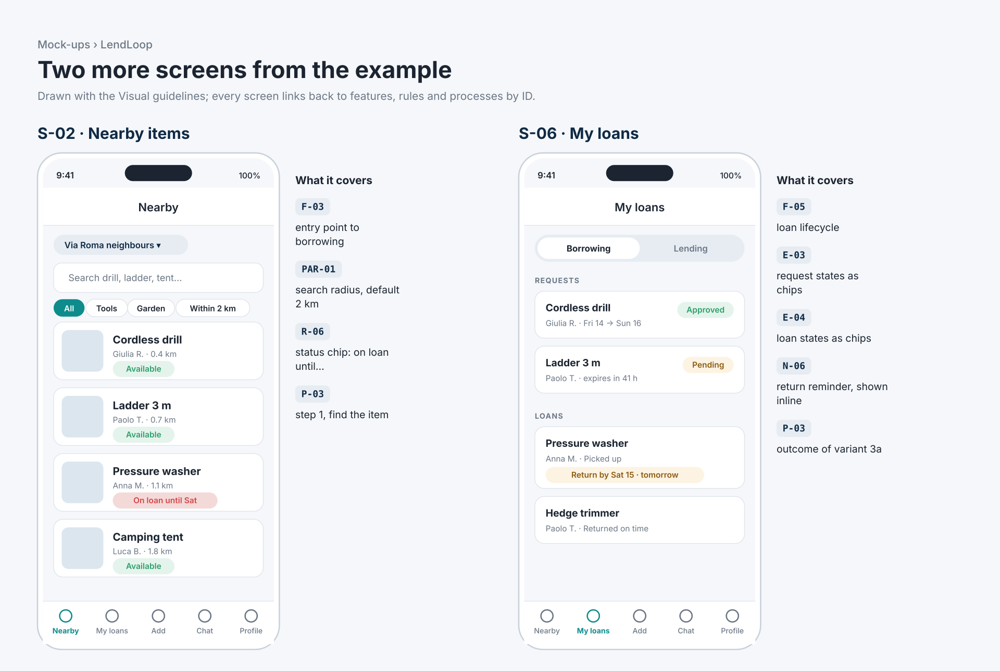
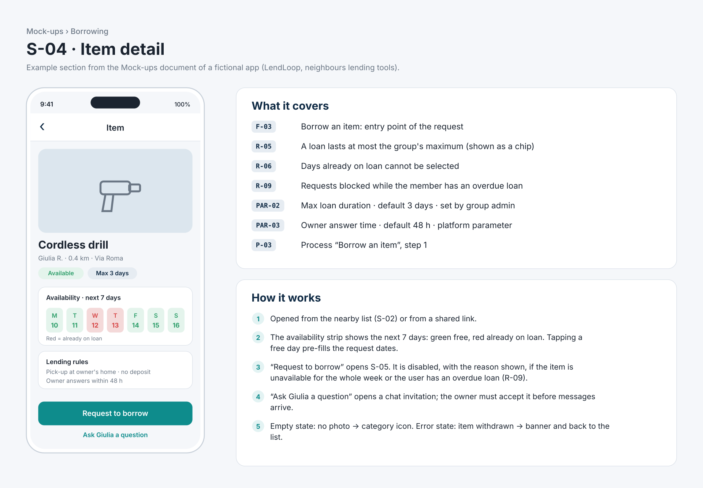

# LendLoop: Mock-ups

| Version | Date | Status | Purpose |
|---|---|---|---|
| 1.0 | 2026-11-25 | validated | Screens of the app, linked to features and rules |

Form factor: mobile first (phones, portrait). Style: [Visual guidelines](03-visual-guidelines.md). The screens are linked into a clickable [navigable prototype](prototype/index.html) (see [Processes](05-processes.md)).

## Screen index
| ID | Screen | Area | Features |
|---|---|---|---|
| S-01 | Sign in | Account | F-01 |
| S-02 | Nearby items | Borrowing | F-03 |
| S-03 | Add item | Lending | F-04 |
| S-04 | **Item detail** | Borrowing | F-03, F-04 |
| S-05 | Borrow request | Borrowing | F-03 |
| S-06 | My loans | Loans | F-05 |
| S-07 | Owner requests | Lending | F-03, F-09 |
| S-08 | Loan confirmed / loan detail | Loans | F-03, F-05 |
| S-09 | Chat | Chat | F-06 |
| S-10 | Group settings | Groups | F-02, F-08 |
| S-11 | Profile | Account | F-01, F-09 |

---

## S-02 · Nearby items

### What it covers
- **F-03** Borrow an item: entry point
- **PAR-01** Search radius · default 2 km · set by the member
- **R-06** The status chip shows when an item is on loan ("On loan until Sat")
- **P-03** Process "Borrow an item", step 1

### How it works
1. Home screen of the app. It shows the items of the selected group, nearest first, within the search radius.
2. The group selector switches between the member's groups.
3. Search and category chips filter the list. "Within 2 km" opens the radius setting.
4. Tapping an item opens S-04.
5. Empty state: no items in the group yet → invitation to add the first one (S-03).

---

## S-04 · Item detail

### What it covers
- **F-03** Borrow an item: entry point of the request
- **R-05** A loan lasts at most the group's maximum (shown as a chip)
- **R-06** Days already on loan cannot be selected
- **R-09** Requests blocked while the member has an overdue loan
- **PAR-02** Max loan duration · default 3 days · set by the group admin
- **PAR-03** Owner answer time · default 48 h · platform parameter
- **P-03** Process "Borrow an item", step 1

### How it works
1. Opened from the nearby list (S-02) or from a shared link.
2. The availability strip shows the next 7 days: green means free, red means already on loan. Tapping a free day pre-fills the request dates.
3. "Request to borrow" opens S-05. If the item is unavailable for the whole week, or the member has an overdue loan (R-09), the button is disabled and the reason is shown.
4. "Ask Giulia a question" opens a chat invitation (F-06). The owner must accept it before messages arrive.
5. Empty state: no photo → category icon. Error state: item withdrawn → banner, then back to the list.

---

---

## S-06 · My loans

Shown next to S-02 in the image above.

### What it covers
- **F-05** Loan lifecycle
- **E-03 / E-04** Request and loan states, shown as chips
- **N-06** Return reminder, also shown inline ("Return by Sat 15 · tomorrow")
- **P-03** Outcome of variant 3a (a declined request appears here)

### How it works
1. Two tabs: *Borrowing* (what I asked for) and *Lending* (my items lent to others).
2. **Requests** shows pending, approved, declined and expired requests. Pending ones show the remaining answer time (PAR-03).
3. **Loans** shows active and past loans. A loan due within PAR-04 shows the warning chip; an overdue one turns red.
4. Tapping a row opens the loan or request detail (S-08).
5. Empty state: nothing borrowed yet → shortcut to S-02.

---

## Other screens
S-05, S-07 and S-08 appear in the screen sequence of [P-03](05-processes.md#p-03--borrow-an-item). The remaining screens follow the same section structure. They are omitted in this example.
