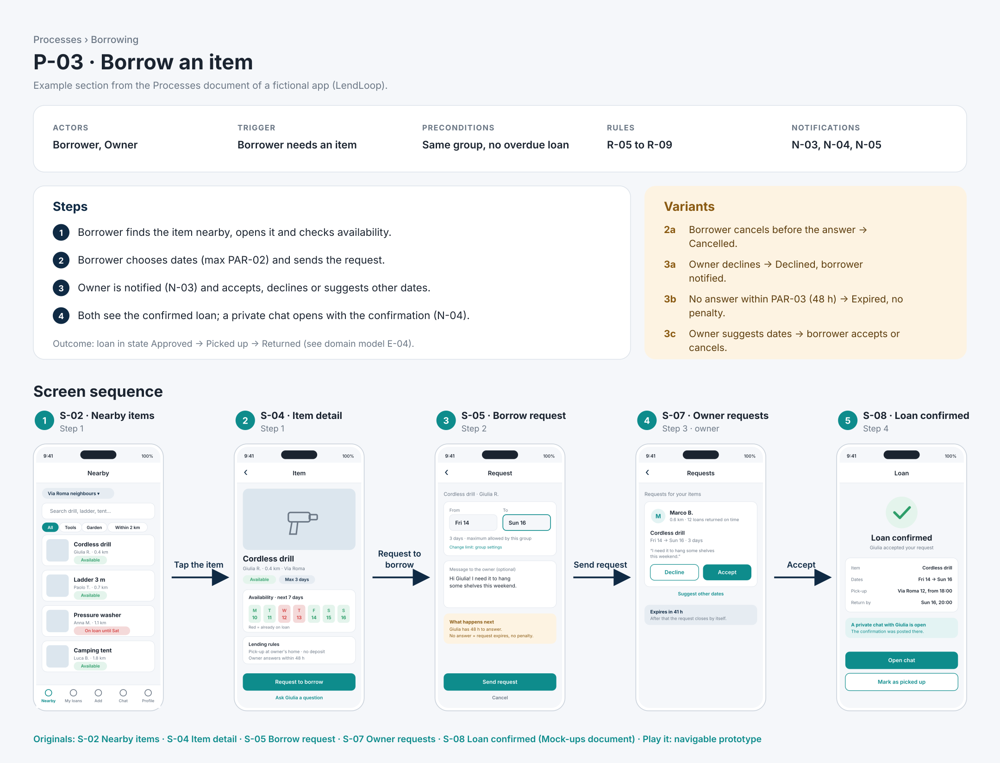
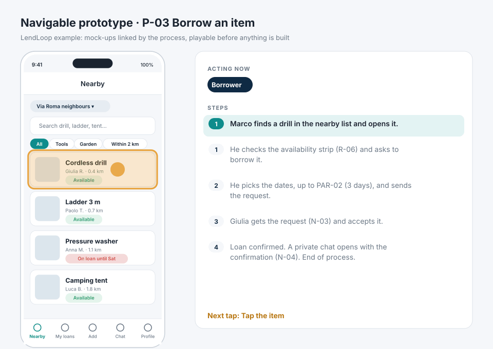

# LendLoop: Processes

| Version | Date | Status | Purpose |
|---|---|---|---|
| 1.0 | 2026-11-25 | validated | End-to-end flows across screens and roles |

## Process index
| ID | Process | Actors | Features |
|---|---|---|---|
| P-01 | Join a group | Member, Group admin | F-02 |
| P-02 | Lend an item | Member | F-04 |
| P-03 | **Borrow an item** | Borrower, Owner | F-03, F-06 |
| P-04 | Pick up and return | Borrower, Owner | F-05, F-09 |
| P-05 | Handle an overdue loan | Borrower, Owner, Group admin | F-05 |
| P-06 | Change group rules | Group admin | F-08 |

**Navigable prototype:** [prototype/index.html](prototype/index.html) links the mock-ups along P-03 (main path and variant 3a). The other processes are not linked in this excerpt.

---

## P-03 · Borrow an item

| Actors | Trigger | Preconditions | Rules | Notifications |
|---|---|---|---|---|
| Borrower, Owner | Borrower needs an item | Both in the same neighbourhood group; borrower has no overdue loan (R-09) | R-05, R-06, R-07, R-08, R-09 | N-03, N-04, N-05 |

### Steps
1. The borrower finds the item in the nearby list (S-02), opens it (S-04) and checks the availability strip.
2. The borrower chooses dates, up to the maximum in PAR-02, and sends the request (S-05). The request is now *Pending*.
3. The owner is notified (N-03) and accepts, declines or suggests other dates (S-07).
4. Both see the confirmed loan (S-08). A private chat opens with the confirmation (N-04). The loan is now *Approved*.

### Variants
- **3a** The owner declines → the request is *Declined* and the borrower is notified (N-05).
- **3b** No answer within PAR-03 (48 h) → the request is *Expired*, with no penalty (R-07). The borrower is notified (N-05).
- **3c** The owner suggests other dates → the borrower accepts (go to step 4) or cancels (request *Cancelled*).
- **2a** The borrower cancels before the owner answers → the request is *Cancelled* (R-08).

### Outcome
The loan follows *Approved → Picked up → Returned* (see [E-04](06-solution-design.md#1-domain-model-and-states)). The pick-up and return are covered by P-04.

### Screen sequence
1. S-02 Nearby items (step 1) → *Tap the item* →
2. S-04 Item detail (step 1) → *Request to borrow* →
3. S-05 Borrow request (step 2) → *Send request* →
4. S-07 Owner requests (step 3, owner) → *Accept* →
5. S-08 Loan confirmed (step 4)

Originals: [S-02](04-mockups.md#s-02--nearby-items) · [S-04](04-mockups.md#s-04--item-detail) · S-05 · S-07 · S-08 (Mock-ups document)

### Play it
The main path and variant 3a can be played in the [navigable prototype](prototype/index.html). Download the file and open it in a browser.

