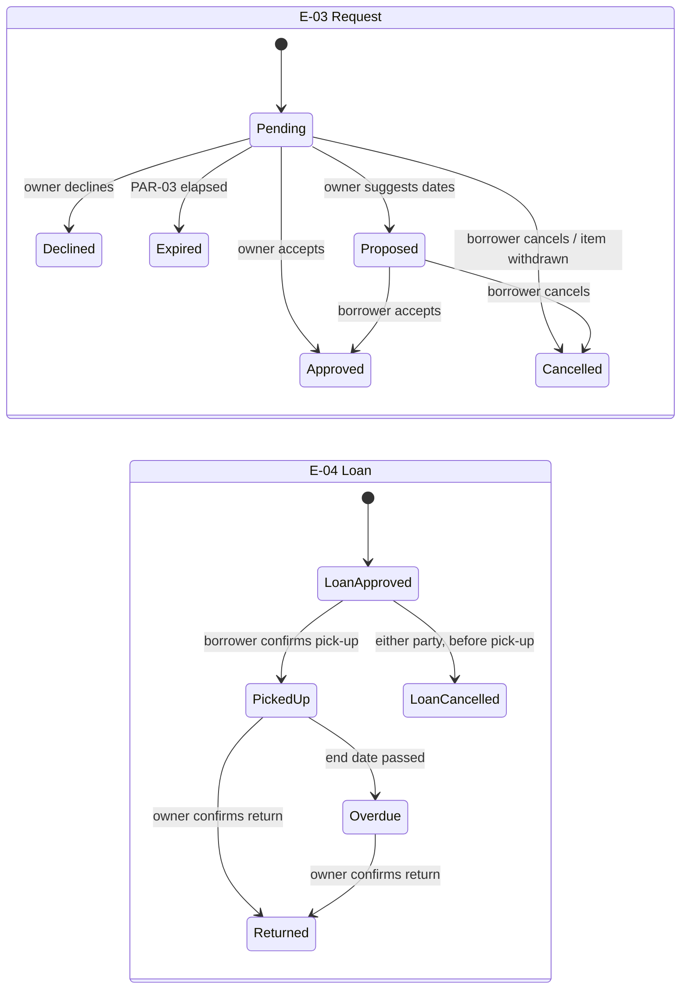

# LendLoop: Solution design

| Version | Date | Status | Purpose |
|---|---|---|---|
| 1.0 | 2026-11-25 | validated | How the solution is structured |

> *Example excerpt: the aspects most related to F-03 are complete; the others are summarised.*

## 1. Domain model and states

| ID | Entity | Key relations |
|---|---|---|
| E-01 | Member | belongs to many Groups |
| E-02 | Group | has Members, Rules (PAR-02) |
| E-03 | Request | Item, Borrower, dates |
| E-04 | Loan | created from an accepted Request |
| E-05 | Item | Owner, Groups where visible |
| E-06 | Chat / Message | two Members, optional Loan |

Check against the Master: R-07 → *Expired*; R-08 → *Cancelled* from *Pending*; R-09 is based on any Loan in *Overdue*.

## 2. Roles and permissions
| Action | ROLE-MB | ROLE-GA | ROLE-PA |
|---|---|---|---|
| Send a request (F-03) | ✓ same group, no overdue loan | ✓ same conditions | — |
| Accept / decline a request | ✓ own items only | ✓ own items only | — |
| Cancel own pending request | ✓ | ✓ | — |
| Change PAR-02 | — | ✓ own groups | — |
| Change PAR-03 | — | — | ✓ |
| Remove an item from the group | own items | ✓ (R-12, logged) | ✓ |

## 3. Parametrisation
| ID | Parameter | Level | Default | Range | Changed by | Used in |
|---|---|---|---|---|---|---|
| PAR-01 | Search radius | user | 2 km | 0.5–10 km | Member | S-02 |
| PAR-02 | Max loan duration | user (group) | 3 days | 1–14 days | Group admin | R-05, S-04, S-05 |
| PAR-03 | Owner answer time | platform | 48 h | 12–96 h | Platform admin | R-07, S-05, S-07 |
| PAR-04 | Return reminder | platform | 1 day before end | 0–3 days | Platform admin | N-06 |
| PAR-05 | Overdue reminder interval | platform | 24 h | 12–72 h | Platform admin | N-07 |
| PAR-06 | Max photos per item | platform | 5 | 1–10 | Platform admin | S-03 |
| FF-waitlist | Waiting list (future) | feature flag | off | on/off | Platform admin | — |

Group parameters are explained with one discreet line under each field in S-10.

## 4–5. Modularity and integrations (summary)
Pluggable push provider (INT-01) and map/geocoding provider (INT-02), each behind its own interface.

## 6–7. Form factor and app type
Mobile first. Cross-platform app (iOS and Android) from a single code base. A web version is not in scope for the first release.

## 8. Audit and traceability
Every state change of E-03 and E-04 is logged with actor, timestamp and before/after state. Group admins can see the history of their groups. Nothing is hard-deleted.

## 11. Notifications
| ID | Event | Recipients | Channel | Can disable |
|---|---|---|---|---|
| N-03 | New request | Owner | push + in-app | no |
| N-04 | Request accepted | Borrower and owner | posted in their private chat + push | no |
| N-05 | Request declined / expired / cancelled | Borrower | push + in-app | yes (push only) |
| N-06 | Return reminder | Borrower | push | yes |
| N-07 | Loan overdue | Borrower, then owner | push + in-app | no |

## 14. Data lifecycle (summary)
Exact address never shown before a loan is accepted. On account deletion, the name is kept as "Former member" in the history of others' loans.

## 19. Measurable NFRs
| ID | Requirement |
|---|---|
| NFR-01 | S-02 list loads in < 1.5 s (p95) on 4G |
| NFR-02 | Request notification delivered in < 30 s (p95) |
| NFR-03 | 99.5% monthly availability |
| NFR-04 | 20,000 members, peaks of 50 requests/min at the weekend |
