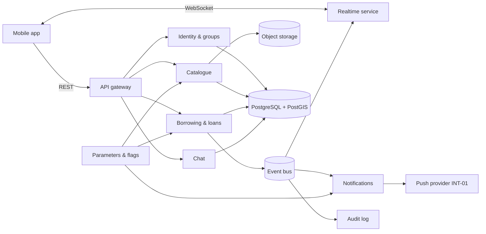
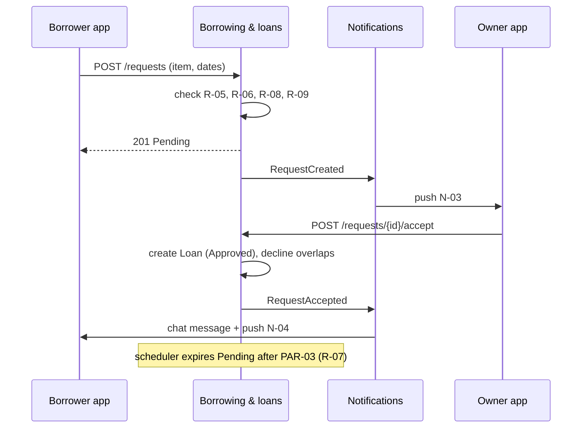

# LendLoop: Architecture

| Version | Date | Status | Purpose |
|---|---|---|---|
| 1.0 | 2026-11-25 | validated | Technical architecture and decisions |

## 1. Drivers
NFR-01 to NFR-04, LEG-02 (location privacy), EU data residency (GDPR), a two-person team, low running costs.

## 2. Stack
| Layer | Choice | Why |
|---|---|---|
| Mobile app | React Native (Expo), TypeScript | One code base for iOS and Android; small team |
| Backend | Node.js (TypeScript), REST + WebSocket | Shared language with the app |
| Database | PostgreSQL with PostGIS | Relational states plus distance queries |
| Files | S3-compatible object storage, EU region | Item photos |
| Push | Pluggable provider (INT-01), default FCM/APNs | ARC-03 |
| Hosting | Managed containers, EU region | Low ops effort |

## 3–4. Modules and interactions

### Key sequence: P-03 Borrow an item

## 7. Parameters and flags
A configuration table with per-group overrides, cached for 60 s. Every change is written to the audit log.

## 8. Deployment
Staging and production in an EU region. CI runs the test plan on every pull request. Mobile releases go through EAS builds, with over-the-air updates for non-native changes.

## 12. Decisions
| ID | Decision | Consequence |
|---|---|---|
| ARC-01 | Monolith with modules, not microservices | Simple to run; modules can be split later |
| ARC-02 | Request expiry handled by a scheduler, not by client timers | R-07 is enforced even when no app is open |
| ARC-03 | Push behind an interface | Provider can change without touching business logic |
